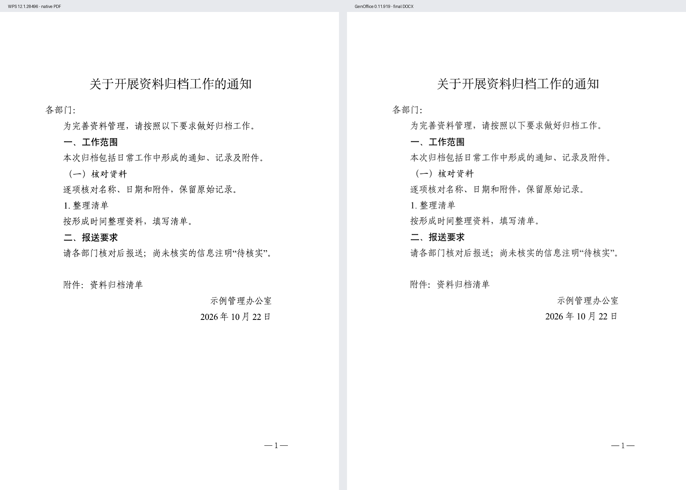
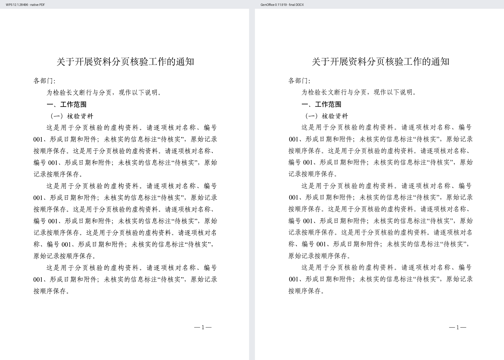
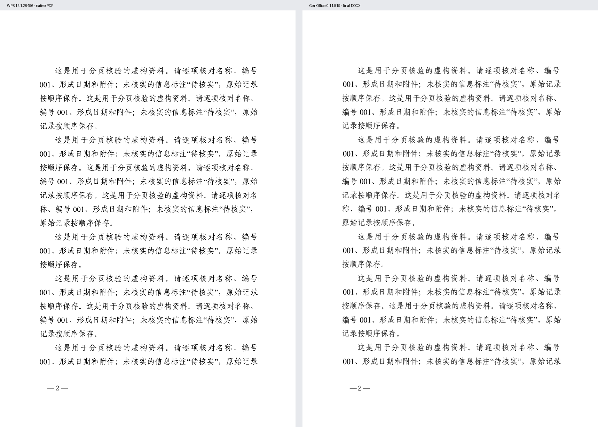
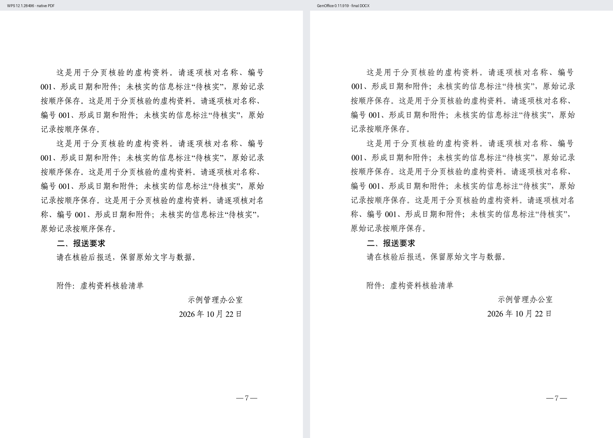

# WPS「公文主体」同文验收

2026-10-22，macOS WPS Office **12.1.28496** 与 GenOffice **0.11.919** 实测。

**本次单页和七页样稿的页数、正文断行一致，标题、层级、附件、署名与奇偶页码已完成校准。** 仍有少量字形位置差异：在 849 × 1200 的整页对照图中，单页文字行顶部相差 0–2px，日期最左侧字形相差 4px，抽查页码边界相差 0–1px。当前发布为 **v1.1.0-beta.1 校准版**。

## 对照方法

1. 使用仓库的虚构[通知原文](../genoffice-official-typeset/examples/通知原文.txt)，在 WPS 中实际执行 AI 公文排版 →「公文主体」，保存 DOCX。提取页面、段落、样式、网格和动态页码的 OOXML 参数。
2. WPS 的自动识别在标题编号后加了空格，并把署名填到了日期位置。原生参考稿仅校正这些文字识别错误，保留模板版式；技能保留原文。
3. 通过 WPS 原生打印导出 PDF；GenOffice 直接渲染最终交付 DOCX，预览使用 144dpi。两边整页统一到 849 × 1200 后比较，不裁剪或平移内容。
4. [七页原文](../genoffice-official-typeset/examples/多页核验原文.txt)使用同一套实测规则生成参考稿，保留正确的 settings 关系、东亚布局和默认标点设置，再用 WPS 原生打印。它用于检验布局引擎，段落分类沿用技能方案。全部七页通过本机文字识别核对断行，并结合原文与页面复核识别误差。

日常使用不依赖 WPS。字体使用本次 WPS 实际加载的字族，见[规则与字体映射](../genoffice-official-typeset/references/wps-body-calibration.md)。

## 单页通知

覆盖标题、主送、正文、一至三级标题、附件、署名、日期和页码。14 行文字及页码，WPS 与 GenOffice 均为 1 页，断行一致。

左：WPS 原生 PDF；右：GenOffice 最终 DOCX。

## 七页长文

包含中文标点、引号、数字 001、长段落及跨页段落。两边均为 7 页，各页文字行数为 **20、22、21、21、22、21、17**（不含页码），逐行起止一致。保留 WPS 默认标点设置；额外强制标点压缩会改变断行，正式入口不添加该开关。

第一页：

第二页，页码在左侧：

末页，署名、日期和动态页码 7：

原图及[测量记录](calibration/measurements.json)随仓库保存。图中均为虚构内容。

## 兼容处理和当前边界

- 明确写入固定行距与零段前、段后距，消除源文件默认样式的污染。
- 在技能拥有的段落内使用 WPS 实际字族，保留原表格、图片、编号和页眉。纯中文标题的西文字体槽用于修正 GenOffice 行框度量，中文实际字形保持原字族。
- 将页码浮动框的 outside 定位解析为奇右偶左，并补偿 GenOffice 的 5pt 垂直偏移。PAGE 字段保持动态；最终 DOCX 与预览使用同一文件。
- 当前仍有上述 0–4px 字形位置差异和字体栅格化差异。含英文或数字的主标题、长附件、复杂对象布局、不同字体版本与其他 WPS 模板需追加同文验收。

每份新文档的报告保留 `visualParity: not-verified`，由实际页面检查记录该文档的验收结果。本页描述的是以上两份固定样稿的实测结果。

## 回归检查

已运行识别与原文保留测试、实测 OOXML 覆盖测试、GenOffice 实际导入/排版/读取/检查/渲染，以及技能格式校验。覆盖空格、制表符、换行、空段、样式隔离、表格图片、自动编号、分节与原页眉、settings 关系、禁止覆盖和动态页码。两份样稿的结构检查均为 0 错误、0 警告，原文与应用文件校验值保持不变。
